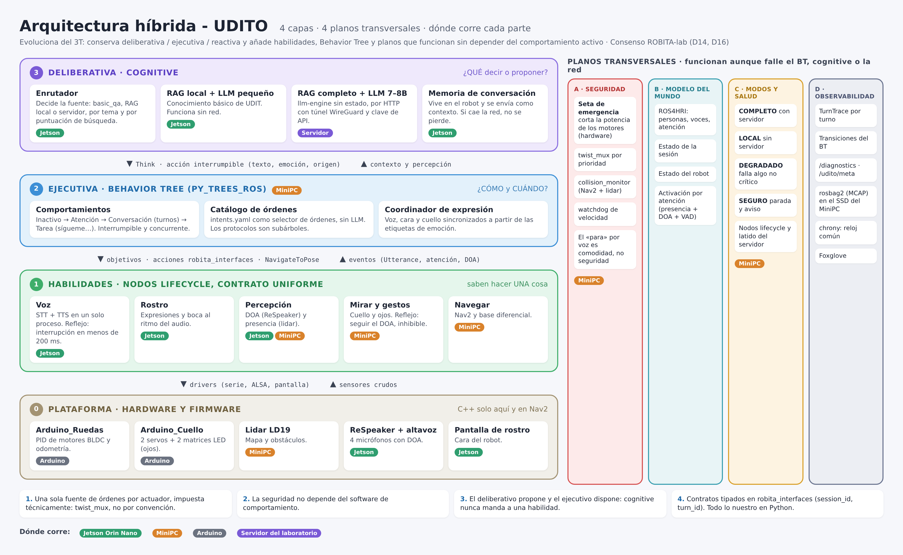

# Arquitectura híbrida - UDITO

Asistente por voz del robot social **UDITO** (ROBITA-lab, UDIT) integrado en **ROS 2 Humble**. Rama: `feature/ros2-voice-orchestrator`.



---

## 1. ¿Qué es la arquitectura híbrida?

Es la evolución del modelo **3T** (*Three-Tier*: deliberativa, ejecutiva y reactiva) acordada en el
documento de consenso del equipo (`docs/ARQUITECTURA_CONSENSO.md`, rama `feature/architecture-consensus`, D14).
Conserva la idea de capas y añade lo que al 3T le faltaba: comportamiento interrumpible y concurrente,
seguridad impuesta por construcción, modos de funcionamiento y trazas para evaluar.

**Cuatro capas** (las órdenes bajan, los datos suben):

| Capa | En UDITO | Pregunta | Analogía de empresa |
|------|----------|----------|---------------------|
| **3 · Deliberativa** | `cognitive`: enrutador, RAG local (Jetson) y RAG + LLM grande (servidor), memoria de conversación | **¿QUÉ** digo o propongo? | Dirección |
| **2 · Ejecutiva** | Behavior Tree con `py_trees_ros` en el MiniPC. Hoy: C.C. `udito_cc` | **¿CÓMO** y **CUÁNDO**? | Jefe de proyecto |
| **1 · Habilidades** | Voz (STT + TTS), rostro, percepción, mirar y gestos, navegar | Saben hacer **una** cosa | Especialistas |
| **0 · Plataforma** | Arduinos, lidar, ReSpeaker, pantalla | Hardware y firmware | Instalaciones |

**Cuatro planos transversales** (funcionan aunque falle el comportamiento, `cognitive` o la red):
**A** seguridad (`twist_mux`, `collision_monitor`, seta de emergencia) · **B** modelo del mundo (ROS4HRI) ·
**C** modos y salud (COMPLETO / LOCAL / DEGRADADO / SEGURO) · **D** observabilidad (trazas, rosbag2).

**Reglas:** una sola fuente de órdenes por actuador · la seguridad no depende del comportamiento ·
el deliberativo propone y el ejecutivo dispone · contratos tipados en `robita_interfaces` · todo lo nuestro en Python.

| Concepto ROS 2 | Qué es | Analogía |
|----------------|--------|----------|
| **Nodo** | Programa con una sola responsabilidad | Un empleado con un puesto |
| **Topic** | Canal de mensajes con nombre | Un canal de Teams |
| **Acción** | Encargo largo que informa de su avance y se puede cancelar | Un pedido con seguimiento |
| **Lanzador** (`ros2 launch`) | Arranca varios nodos con sus opciones | El turno de apertura |

---

## 2. Estructura del repositorio

| Carpeta | Qué contiene |
|---------|--------------|
| `01_SERVICES/` | **Motores** sin ROS: `stt-engine` (Whisper), `tts-engine` (Piper), `rag-engine`, `voice-face-engine` (voz con emociones, rostro y audio) |
| `02_AGENTS_FACTORY/` | Agentes |
| `03_ADAPTERS/` | **Instalación y configuración** de cada dispositivo que usa UDITO. Sin código ([README](03_ADAPTERS/README.md)) |
| `04_KNOWLEDGE_CORE/` | **Conocimiento**: documentos, índices, grafos y respuestas fijas |
| `05_ROS2/` | **Solo ROS 2.** UDITO son dos proyectos: `central_control` (C.C.) y `voice_skills` (oído y voz) |
| `docs/` | Arquitectura |
| `scripts/` | Atajos de instalación y lanzamiento (el robot también arranca sin ellos) |

```
cognitive-robotics-core/
├── 03_ADAPTERS/UDITO_ROBOT_SOCIAL/Dispositivos/
│   ├── Jetson_Orin_Nano/      # arranque/ (hardware al iniciar Ubuntu) · entorno_ros2/ · COMPONENTES.md
│   ├── MiniPC/                # ejecutivo BT, Nav2, seguridad, grabación
│   ├── Arduino_Ruedas/        # firmware/ de la base
│   ├── Arduino_Cuello/        # cuello y ojos
│   ├── Servidor_Laboratorio/  # LLM grande y RAG completo
│   └── Raspberry/             # reservado
├── 01_SERVICES/voice-face-engine/   # voz con emociones, rostro y audio (sin ROS)
├── 05_ROS2/ros2_ws/src/
│   ├── central_control/       # C.C.: udito_cc_node · intents · console · body_example · cognitive
│   │   ├── config/intents.yaml        # las 20 órdenes
│   │   └── launch/udito_voice.launch.py
│   └── voice_skills/          # oído y voz: stt_node · tts_node
└── scripts/ros2/udito-ros.sh  # atajo `robot`
```

---

## 3. Instalación en la Jetson

Paso a paso en [`03_ADAPTERS/UDITO_ROBOT_SOCIAL/Dispositivos/Jetson_Orin_Nano/README.md`](03_ADAPTERS/UDITO_ROBOT_SOCIAL/Dispositivos/Jetson_Orin_Nano/README.md).
Ruta del repo: **`/opt/cognitive-robotics-core`**.

Los ajustes de hardware (frecuencias al máximo, ReSpeaker reservado para el robot, snap en pausa) se aplican
**solos al iniciar Ubuntu**; no hace falta ejecutarlos antes de arrancar el robot.

---

## 4. Cómo usar

### 4.1 Configurar el audio (una vez)

```bash
cd /opt/cognitive-robotics-core && ./scripts/udito/audio.sh
```

### 4.2 Arrancar el robot

```bash
ros2 launch central_control udito_voice.launch.py      # nativo ROS 2
robot                                           # atajo: cierra instancias anteriores y compila si hace falta
```

En la **Consola UDITO**: pulsa **ENCENDER**, mantén **MANTÉN PARA HABLAR** (o la barra espaciadora), di la orden y suelta.
También puedes hacer clic en una orden o escribir en **«Haz que diga»** con expresiones: `[feliz] ¡Hola! [sorpresa] ¿En serio?`.

Opciones del lanzador y variables de entorno: [README de `central_control`](05_ROS2/ros2_ws/src/central_control/README.md).

### 4.3 Probar sin voz

```bash
ros2 topic pub --once /udito/stt/text std_msgs/String "{data: sigueme}"
ros2 topic echo /udito/intent
```

---

## 5. Estado y siguientes fases (consenso §6)

| Fase | Contenido | Estado |
|------|-----------|--------|
| Módulo 1 | Órdenes por voz, consola, frases con expresión, boca sincronizada | ✅ Funciona en la Jetson (STT ≈ 1,5 s) |
| F1 | `robita_interfaces` (`Utterance`, `TurnTrace`, `Think`), seta de emergencia, `twist_mux`, medir memoria | Pendiente |
| F2 | Ejecutivo `py_trees_ros` (el catálogo `intents.yaml` como selector) y `cognitive` con `Think` | Pendiente |
| F3–F5 | Datos y red (WireGuard, MCAP), modelo del mundo y modos, Jazzy | Pendiente |

---

## 6. Órdenes disponibles

| # | Orden | Hace | Cuerpo |
|---|-------|------|--------|
| 1 | hola | Saluda | |
| 2 | cómo te llamas | Se presenta | |
| 3 | cuéntame un chiste | Chiste + risa | |
| 4 | ríete | Risa | |
| 5 | sonríe | Cara feliz | |
| 6 | ponte triste | Cara triste | |
| 7 | sorpréndete | Cara de sorpresa | |
| 8 | guiña un ojo | Guiño | |
| 9 | mueve los ojos | Ciclo de expresiones | |
| 10 | duérmete | Cara dormida | |
| 11 | mira a la izquierda | Gira el cuello | `look` |
| 12 | mira a la derecha | Gira el cuello | `look` |
| 13 | asiente | Gesto «sí» | `head_gesture` |
| 14 | niega | Gesto «no» | `head_gesture` |
| 15 | sígueme | Seguimiento | `follow` |
| 16 | para / quieto | Se detiene | `stop` |
| 17 | ven aquí | Se acerca | `go_to` |
| 18 | da una vuelta | Gira 360° | `rotate` |
| 19 | qué hora es | Dice la hora | |
| 20 | dato curioso | Dato curioso | |

### Añadir una orden

1. Añade un bloque en `05_ROS2/ros2_ws/src/central_control/config/intents.yaml` (`id`, `label`, `phrases`, `say`, `face` y, si mueve el cuerpo, `body`).
2. Si tiene `body`, añade su `name` al orquestador del cuerpo.
3. Reinicia con ``robot --build``. No hace falta tocar código.

---


## 7. Voz del robot

Archivo: `01_SERVICES/tts-engine/config/tts_config.json`

| Parámetro | Valor actual | Para qué sirve |
|-----------|--------------|----------------|
| `voice_model` | `es_ES-davefx-medium.onnx` | La voz (archivos en `tts-engine/piper/voices/`) |
| `length_scale` | `1.0` | Velocidad (menor = más rápido) |
| `noise_scale` | `0.667` | Expresividad de la entonación |
| `noise_w` | `0.8` | Variación del ritmo |
| `sentence_silence` | `0.3` | Pausa entre frases (segundos) |

---


## 8. Red y acceso remoto

| Interfaz | IP fija | Uso |
|----------|---------|-----|
| LAN (`eno1`) | `10.8.0.132/24`, GW `10.8.0.254` | Laboratorio OFC 309 y servidor del Cognitive |
| Wifi (`wlP1p1s0`) | `10.8.34.5/23`, GW `10.8.35.254` | Robot sin cables (requiere MAC registrada por TI) |

```powershell
ssh udito@10.8.0.132        # desde un PC del mismo segmento (10.8.0.x)
```

NoMachine: puerto `4000`. La red de la universidad bloquea el tráfico entre segmentos distintos.

---


## 9. Problemas frecuentes

| Síntoma | Causa | Solución |
|---------|-------|----------|
| STT muy lento (>10 s) | El servicio de arranque no está activo | `systemctl is-active udito-jetson-arranque.service` (ver `Jetson_Orin_Nano/arranque`) |
| Sin sonido, «Device or resource busy» | PulseAudio tiene el ReSpeaker | Regla udev de `Jetson_Orin_Nano/arranque` instalada y reinicio |
| `ros2: command not found` | Entorno ROS 2 no instalado para todos | `Jetson_Orin_Nano/entorno_ros2` |
| `Package 'central_control' not found` | Paquete sin compilar | `cd 05_ROS2/ros2_ws && colcon build --packages-select central_control voice_skills --symlink-install` |
| `Exec format error` en Piper | Binario de PC en vez de ARM | `./scripts/setup/piper-jetson.sh` |
| Respuestas duplicadas | Dos instancias corriendo | Arrancar con `robot`, que cierra las anteriores |

---

## 10. Flujo de trabajo Git

Ver [`GIT-FLOW.md`](GIT-FLOW.md). Trabajo en `feature/ros2-voice-orchestrator` → Pull Request a `develop` tras aprobación.

**Autor:** Danilo Guevara — ROBITA-lab, UDIT.
